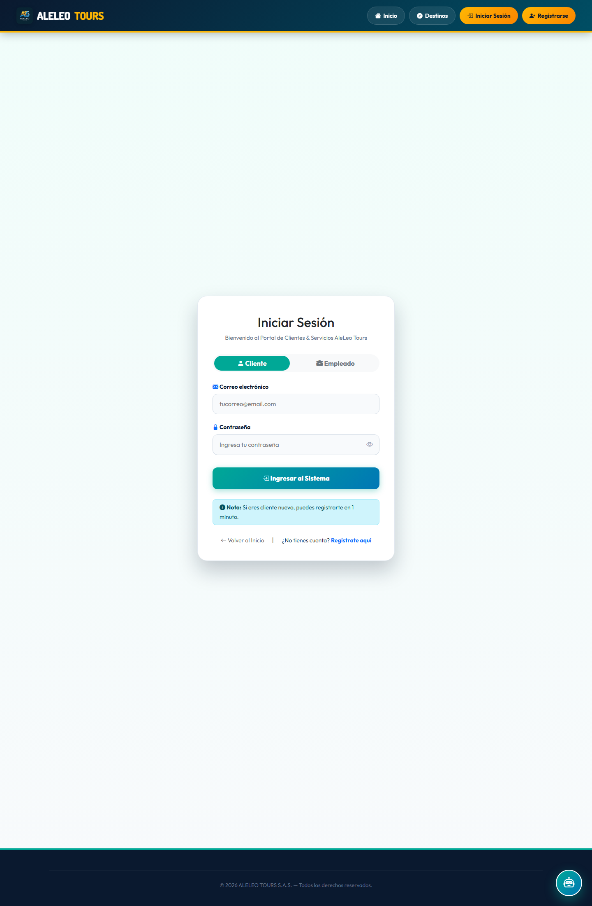
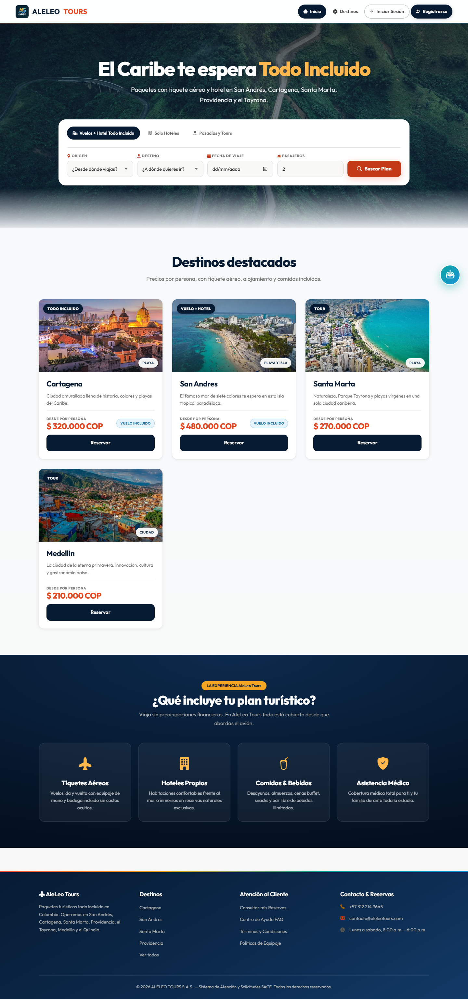
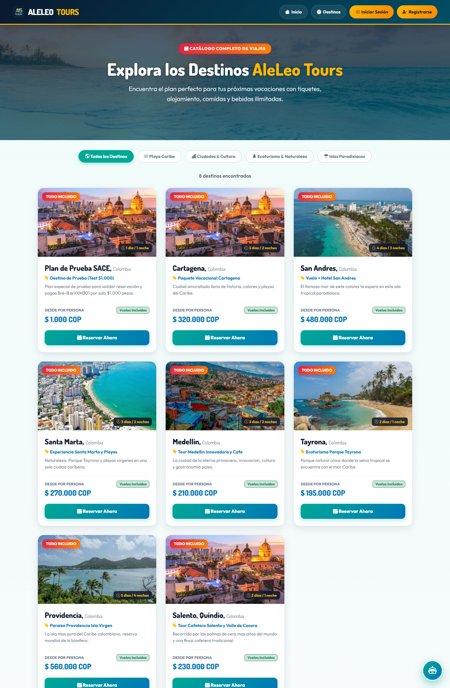

# Despliegue de SACE: comprobante, detalle técnico y operación

_Proyecto académico AleLeo Tours (SENA) · Ficha / Grupo: 3171149-B_
_Cesar Leonardo Ramírez Montejo · Yerson Alexei Torres Garcia · Felipe Gonzales Quitero_
_Actualizado: 10 de noviembre de 2026_

> **Qué es este documento.** Reúne la **evidencia** de lo que se verificó al
> desplegar y el **detalle técnico** de por qué la configuración funciona así.
> No repite el plan ni los pasos: eso está en el documento 04.
>
> | Documento | Función |
> |---|---|
> | [`04-Plan-de-Despliegue-SACE.md`](04-Plan-de-Despliegue-SACE.md) | Plan, dependencias y guía paso a paso (local, nube y VPS) |
> | **`06` (este)** | Evidencia real, decisiones técnicas y operación |
> | [`deploy/.env.example`](../deploy/.env.example) | Plantilla única y comentada de variables de entorno |
> | [`09-Integracion-Pasarela-Pagos-SACE.md`](09-Integracion-Pasarela-Pagos-SACE.md) | Pasarela de pagos y webhook |

---

## 6.1 Servicios desplegados

| Entorno | Componente | Plataforma | URL |
|---|---|---|---|
| Local | Base de datos | PostgreSQL 18.4 | `localhost:5432` — `SACE_db` |
| Local | Backend | Java 17 · Spring Boot 3.2 | `http://localhost:8082/api` |
| Local | Frontend | HTML/CSS/JS · Bootstrap 5.3.3 | `http://localhost:8091` |
| Nube | Frontend | Cloudflare Workers (assets estáticos) | `https://aleleotours.aleleo.workers.dev` |
| Nube | Backend | Render (contenedor desde el `Dockerfile`) | `https://sace-api.onrender.com` |
| Nube | Base de datos | Neon (PostgreSQL 17.11) | `neondb`, conexión directa con `sslmode=require` |

> **Cambio de URL del 11 de noviembre de 2026.** El primer despliegue usó el
> subdominio `cesarleonardo-rm2301.workers.dev`, que Cloudflare asigna por
> defecto. Se cambió a `aleleo` (Workers & Pages → *Change* junto a *Your
> subdomain*), así que el sitio quedó en `https://aleleotours.aleleo.workers.dev`.
> Los logs de las secciones siguientes son los del primer despliegue y por eso
> muestran la URL anterior; el contenido y la configuración son los mismos.
> Al cambiar el origen hay que actualizar `SACE_CORS_ORIGINS` en Render, o el
> navegador recibe **403**.

---

## 6.2 Verificación local del 21 de septiembre de 2026

Los tres componentes se ejecutaron de forma simultánea en el equipo SIKS2301
(Windows 11) y se comprobaron puertos, respuestas HTTP, base de datos y semilla.

### 6.2.1 Comandos utilizados

```
CREATE DATABASE SACE_db;

cd backend-SACE && mvn spring-boot:run          # http://localhost:8082

cd frontend-aleleo-tours && python -m http.server 8091 --bind 127.0.0.1
```

El backend crea el esquema con `ddl-auto=update` y `DataInitializer` siembra el
administrador, el catálogo y las preguntas frecuentes.

### 6.2.2 Salida real

```
== VERIFICACION DE DESPLIEGUE SACE - 21 de septiembre de 2026 ==
Equipo/host: SIKS2301
SO: Microsoft Windows 11 Home Single Language
PostgreSQL (5432): OK - PostgreSQL 18.4 on x86_64-windows, 64-bit
Base SACE_db existe: SI
Tablas en SACE_db: 11
Backend GET /api/servicios - HTTP 200
catalogo de servicios: 7 destinos
Backend POST /api/auth/login - OK (rol: ADMINISTRADOR, token 158 chars)
Frontend GET /login.html - HTTP 200 (8065 bytes)
Frontend GET /index.html - HTTP 200 (17049 bytes)
Frontend GET /destinos.html - HTTP 200 (13160 bytes)
Frontend GET /registro.html - HTTP 200 (9006 bytes)
Puertos escuchando (backend/frontend): 8082, 8091
```

### 6.2.3 Base de datos

`SACE_db` existe con 11 tablas en el esquema `public` (usuarios, solicitudes,
mensajes, servicios, pagos y preguntas frecuentes, entre otras). El DDL completo
se entrega en [`SACE_db_ddl.sql`](SACE_db_ddl.sql); los datos no se distribuyen
porque los genera el sistema al iniciar.

### 6.2.4 Pruebas de humo

| Prueba | Resultado |
|---|---|
| `GET /api/servicios` (catálogo público) | HTTP 200, 7 destinos |
| `POST /api/auth/login` con el admin semilla | HTTP 200, rol ADMINISTRADOR, token firmado |
| Páginas `login`, `index`, `destinos` y `registro` | HTTP 200 en las 4 |
| Suite de regresión CP-01…CP-24 | 92 PASS / 0 FAIL (ver documento 03) |

### 6.2.5 Evidencia visual

Tres capturas del entorno desplegado, también disponibles en
[`capturas/`](capturas/) e indexadas en [`INDICE.md`](INDICE.md):







---

## 6.3 Verificación contra una base vacía (4 de noviembre de 2026)

La verificación de 6.2 se hizo con datos de desarrollo. Esta comprueba la
configuración nueva contra una base **sin ninguna tabla**, que es la situación
exacta de un primer despliegue en Neon o Railway. Se usó una base temporal
`sace_deploy_test` para no alterar los datos de desarrollo.

### 6.3.1 Empaquetado del artefacto

```
cd backend-SACE
mvn -B -ntp clean package -DskipTests

[INFO] Building jar: ...\target\sacejpa-0.0.1-SNAPSHOT.jar
[INFO] Replacing main artifact ... with repackaged archive, adding nested dependencies in BOOT-INF/.
[INFO] BUILD SUCCESS
[INFO] Total time:  33.542 s
```

El `.jar` resultante es ejecutable por sí solo (incluye sus dependencias), que es
lo que copia la imagen Docker en su segunda etapa.

### 6.3.2 Arranque con el perfil de producción

Se ejecutó el `.jar` con las variables de entorno que usaría la plataforma
(`PORT`, `SPRING_DATASOURCE_*`, `SACE_TOKEN_SECRET`, `SACE_ADMIN_PASSWORD`,
`SACE_CORS_ORIGINS`, `SACE_UPLOAD_DIR`, `SACE_DDL_AUTO`, `PAGOS_PASARELA`) y con
los mismos flags de JVM del `Dockerfile`.

```
Starting SacejpaApplication v0.0.1-SNAPSHOT using Java 21.0.12 with PID 17068
HikariPool-1 - Starting...
HikariPool-1 - Added connection org.postgresql.jdbc.PgConnection@5e385b6f
HikariPool-1 - Start completed.
PagoConstraintInitializer: indices de integridad del modulo de pagos verificados
PersonaEmailConstraintInitializer: unicidad de persona.email verificada
Tomcat started on port 8082 (http) with context path ''
Started SacejpaApplication in 14.038 seconds
>>> [SACE SEED] Usuario Administrador creado: admin@aleleotours.com / admin123
>>> [SACE SEED] 6 Servicios turisticos iniciales creados.
>>> [SACE SEED] Preguntas frecuentes iniciales creadas.
>>> [SACE SEED] Chatbot 'AleLeoBot' inicializado.
La aplicacion SaceJPA esta iniciada correctamente
```

La aplicación arrancó en **14 segundos**, por debajo del `start-period=90s` del
`HEALTHCHECK` del `Dockerfile`.

### 6.3.3 Esquema creado desde cero

La base estaba vacía. Hibernate la dejó lista sin intervención manual:

```
== TABLAS EN sace_deploy_test ==
11 tablas
chatbot
chatbot_pregunta_frecuente
cliente
cliente_servicio
empleado
mensaje
pago
persona
pregunta_frecuente
servicio
solicitud
```

### 6.3.4 Endpoint de salud

```
GET http://localhost:8082/api/salud   ->  HTTP 200

{
    "estado":      "OK",
    "aplicacion":  "SACE - Sistema de Atencion al Cliente (AleLeo Tours)",
    "version":     "1.0.0",
    "baseDatos":   "conectada",
    "momento":     "2026-11-05T00:09:48.386541400Z"
}
```

Es el mismo endpoint que consultan Render y Railway para decidir si el contenedor
está sano.

### 6.3.5 Semilla y login con la contraseña del entorno

```
GET /api/servicios  ->  6 servicios
  - Paquete Vacacional Cartagena
  - Vuelo + Hotel San Andres
  - Experiencia Santa Marta y Playas
  - Tour Medellin Innovadora y Cafe
  - Ecoturismo Parque Tayrona
  - Paraiso Providencia Isla Virgen

POST /api/auth/login  { "email": "admin@aleleotours.com", "contrasenia": "<la de SACE_ADMIN_PASSWORD>" }
  -> LOGIN OK
     id    : 1
     email : admin@aleleotours.com
     tipo  : ADMINISTRADOR
     token : eyJzdWIiOjEsImVtYWlsIjoiYWRt...
```

El administrador se creó con la contraseña recibida en `SACE_ADMIN_PASSWORD`, no
con un valor escrito en el código: es la comprobación de que la rotación de
credenciales funciona.

### 6.3.6 CORS y autorización

```
GET /api/salud   Origin: https://www.aleleotours.com
  HTTP 200
  Access-Control-Allow-Origin: https://www.aleleotours.com
  Access-Control-Allow-Credentials: true

GET /api/salud   Origin: https://sitio-malicioso.example
  HTTP 403   (origen no listado en SACE_CORS_ORIGINS: bloqueado, correcto)

GET /api/clientes   (sin token)
  HTTP 401   (ruta protegida: no autorizado, correcto)
```

### 6.3.7 Nota sobre la imagen Docker en el equipo local

El `Dockerfile` no se pudo construir en este equipo: el demonio de Docker se
detuvo durante `mvn dependency:go-offline` con `rpc error: code = Unavailable
desc = error reading from server: EOF`. La causa es la memoria (7,7 GB en total,
~1 GB libre; Docker Desktop reserva cerca de la mitad para su máquina virtual y
Maven dentro del contenedor necesita 1-2 GB más).

Esto no invalida la verificación: el `.jar` probado en 6.3.2 es exactamente el
artefacto que la imagen copia en su segunda etapa, ejecutado con las mismas
variables y los mismos flags de JVM. Render sí construyó la imagen después
(6.4), así que el `Dockerfile` quedó validado en un entorno real.

---

## 6.4 Primer despliegue real en la nube (9 de noviembre de 2026)

Se publicó el sistema completo con la opción A del plan (documento 04). Aquí ya
no hay nada local: los tres componentes están en Internet y se comprobaron desde
fuera.

### 6.4.1 Build y arranque del backend

```
==> Checking out commit 05c5892 in branch main
#20 exporting to image
#20 DONE 0.2s
==> Deploying...
Tomcat initialized with port 10000 (http)
HikariPool-1 - Added connection org.postgresql.jdbc.PgConnection@7d18338b
HikariPool-1 - Start completed.
PagoConstraintInitializer: indices de integridad del modulo de pagos verificados
PersonaEmailConstraintInitializer: unicidad de persona.email verificada
Tomcat started on port 10000 (http) with context path ''
Started SacejpaApplication in 126.497 seconds (process running for 136.023)
==> Your service is live
==> Available at your primary URL https://sace-api.onrender.com
```

Hibernate creó el esquema en Neon, que estaba vacía, y el seed insertó el
administrador, los 6 paquetes turísticos, las preguntas frecuentes y el chatbot.

### 6.4.2 Build y publicación del frontend

Cloudflare ejecutó `npx wrangler deploy` con la configuración de `wrangler.jsonc`:

```
Detected Project Settings:
 - Worker Name: aleleotours
 - Framework: Static
 - Output Directory: frontend-aleleo-tours
Read 94 files from the assets directory
Success! Uploaded 71 files (1.90 sec)
Deployed aleleotours triggers (0.89 sec)
  https://aleleotours.cesarleonardo-rm2301.workers.dev
Success: Build completed.
```

### 6.4.3 Verificación desde Internet

Las once páginas del sitio respondieron `200`, y las cabeceras de
`frontend-aleleo-tours/_headers` se aplicaron de verdad:

```
GET /                          -> 200
GET /login  /registro  /destinos  /mis-solicitudes  /reportes
GET /panel-empleado  /gestion-solicitudes  /gestion-servicios
GET /gestion-clientes  /gestion-empleados              -> 200 (las once)

GET /css/style.css
  HTTP 200
  Cache-Control: public, max-age=604800
  Strict-Transport-Security: max-age=31536000; includeSubDomains
  X-Content-Type-Options: nosniff
  X-Frame-Options: SAMEORIGIN
  Referrer-Policy: strict-origin-when-cross-origin
  Permissions-Policy: geolocation=(self), camera=(), microphone=(), payment=()
```

En un navegador real, la portada cargó los destinos desde la API, no desde el
HTML:

```
GET https://sace-api.onrender.com/api/servicios               -> 200
GET https://sace-api.onrender.com/api/preguntas-frecuentes    -> 200
```

### 6.4.4 Salud, CORS y autorización

```
GET https://sace-api.onrender.com/api/salud
  HTTP 200 en 0.39 s
  {"estado":"OK","aplicacion":"SACE - Sistema de Atencion al Cliente (AleLeo Tours)",
   "version":"1.0.0","baseDatos":"conectada","momento":"2026-11-09T16:04:54Z"}

GET /api/servicios   Origin: https://aleleotours.cesarleonardo-rm2301.workers.dev
  HTTP 200
  Access-Control-Allow-Origin: https://aleleotours.cesarleonardo-rm2301.workers.dev
  Access-Control-Allow-Credentials: true

GET /api/servicios   Origin: https://sitio-no-listado.example
  HTTP 403   (correcto)

GET /api/clientes    (sin token)
  HTTP 401   (correcto)
```

Los 6 servicios devueltos por la API: Paquete Vacacional Cartagena, Vuelo + Hotel
San Andrés, Experiencia Santa Marta y Playas, Tour Medellín Innovadora y Café,
Ecoturismo Parque Tayrona y Paraíso Providencia Isla Virgen.

### 6.4.5 Flujo de pago verificado de punta a punta

Con una cuenta de administrador real se creó una solicitud, se cotizó y se pagó
en modo `mock` (pasarela `SIMULADA`):

| Paso | Llamada | Resultado |
|---|---|---|
| 1 | `POST /api/solicitudes` con `clienteId` y `servicioGeneradoId` | solicitud creada, `GET /api/solicitudes/{id}` confirma ambos campos |
| 2 | `GET /api/pagos/cotizacion/{id}` | **200**, monto 320.000,00 COP |
| 3 | `POST /api/pagos` con `{ solicitudId, metodoPago: "TARJETA" }` | `PAGO-…`, pasarela `SIMULADA`, estado `PENDIENTE` |
| 4 | `GET /api/pagos/estado/PAGO-…` | **APROBADO**, `comprobanteDisponible: true` |
| 5 | `GET /api/pagos/comprobante/{idPago}` | **200**, `application/pdf`, 1 página |

El PDF se regenera desde la base si el archivo no está en el disco, así que el
cliente nunca recibe un 404 por un redespliegue.

### 6.4.6 Dos fallos que costaron tiempo (y su causa)

1. **`error code: 1042` en todas las rutas del frontend.** El deploy decía
   `Success`, pero cualquier ruta —incluso un subdominio inventado dentro de la
   misma cuenta— devolvía 1042. La causa: `workers.dev` no estaba habilitado
   para ese Worker. Se corrigió en *Worker → Settings → Domains & Routes →
   `workers.dev` → Enable*.
2. **CORS en `403` con todos los orígenes.** `SACE_CORS_ORIGINS` en Render
   seguía apuntando a una URL que el sitio ya no usaba. Se cambió al origen
   exacto del Worker y, tras el redespliegue automático, las peticiones
   pasaron a `200`.

### 6.4.7 Nota sobre el tiempo de arranque

El primer arranque tardó **126 s**, frente a los 14 s de la prueba local (6.3.2).
La diferencia no es del código: en el primer arranque Hibernate tiene que crear
las 11 tablas contra Neon, que está en otra red. En arranques posteriores el
esquema ya existe y el tiempo baja. Aun así, el plan gratuito de Render apaga el
servicio a los 15 minutos sin tráfico y la primera petición después tarda en
volver a levantar el contenedor.

---

## 6.5 Arquitectura y flujo de una petición

```
 Navegador
    │
    │  1. GET https://www.aleleotours.com/index.html
    ▼
┌──────────────────────────────────────────────────────────────┐
│ FRONTEND (estático)                   Cloudflare Workers     │
│   frontend-aleleo-tours/  →  CDN global, HTTPS, sin build    │
│   js/core/config.js resuelve la URL del API                  │
└───────────────────────┬──────────────────────────────────────┘
                        │  2. fetch(`${API_BASE}/servicios`)
                        │     con cabecera Origin
                        ▼
┌──────────────────────────────────────────────────────────────┐
│ BACKEND (Spring Boot 3.2 / Java 17)    Render / Railway      │
│   AuthInterceptor → valida el token de sesión                │
│   WebConfig       → valida el Origin (CORS)                  │
│   Controlador     → lógica de negocio                        │
└───────────────────────┬──────────────────────────────────────┘
                        │  3. JDBC (pool Hikari)
                        ▼
┌──────────────────────────────────────────────────────────────┐
│ PostgreSQL 18                     Neon / Railway / volumen   │
│   SACE_db: 11 tablas                                         │
└──────────────────────────────────────────────────────────────┘
```

Decisiones de diseño relevantes:

- **Separar frontend y backend** no es una preferencia estética. El frontend es
  HTML/CSS/JS puro: un CDN lo sirve gratis, sin límite de visitas y con HTTPS
  automático. El backend es una aplicación Java que necesita un proceso vivo y
  memoria. Publicarlos juntos obligaría a pagar servidor por un sitio que no lo
  necesita.
- **Un único dominio para el API** (`api.aleleotours.com`) evita problemas de
  CORS y da una URL estable y HTTPS para el webhook de Wompi.
- **El esquema lo crea Hibernate** en el primer arranque. Es lo que permite que
  una base vacía (Neon) quede lista sin scripts manuales.

---

## 6.6 Por qué se cambió el backend

### 6.6.1 `application.properties`: de valores fijos a variables de entorno

**Antes** el archivo contenía el puerto, el usuario y la contraseña de la base,
la clave de firma de tokens y las llaves de Wompi escritas literalmente. Ese
archivo viaja en el repositorio, así que publicar el proyecto equivalía a
publicar los secretos.

**Ahora** cada valor sensible usa la sintaxis `${VARIABLE:valor_por_defecto}` de
Spring:

| Propiedad | Variable de entorno | Valor por defecto |
|---|---|---|
| `server.port` | `PORT` | `8082` |
| `spring.datasource.url` | `SPRING_DATASOURCE_URL` | `jdbc:postgresql://localhost:5432/SACE_db` |
| `spring.datasource.username` | `SPRING_DATASOURCE_USERNAME` | `postgres` |
| `spring.datasource.password` | `SPRING_DATASOURCE_PASSWORD` | `1234` |
| `spring.jpa.hibernate.ddl-auto` | `SACE_DDL_AUTO` | `update` |
| `spring.jpa.show-sql` | `SACE_SHOW_SQL` | `true` |
| `app.security.token.secreto` | `SACE_TOKEN_SECRET` | Clave de desarrollo |
| `app.cors.origins` | `SACE_CORS_ORIGINS` | `http://localhost:*,http://127.0.0.1:*` |
| `app.upload.dir` | `SACE_UPLOAD_DIR` | `uploads/comprobantes` |
| `app.admin.email` | `SACE_ADMIN_EMAIL` | `admin@aleleotours.com` |
| `app.admin.password` | `SACE_ADMIN_PASSWORD` | vacío |
| `app.pagos.pasarela` | `PAGOS_PASARELA` | `mock` |
| `app.pagos.wompi.*` | `WOMPI_*` | vacío |

Además se añadieron dos ajustes propios de producción:

- **`server.forward-headers-strategy=framework`**: detrás de nginx o Cloudflare,
  la petición original llega por HTTPS pero al contenedor le llega por HTTP. Sin
  esto, Spring generaría URLs `http://` y las redirecciones fallarían.
- **Pool de conexiones acotado** (`SACE_DB_POOL_SIZE`, por defecto 10): en una
  PaaS hay un solo contenedor y una base compartida; un pool grande agota los
  límites de conexiones del proveedor.

**Por qué tiene valor por defecto cada variable:** el proyecto debe seguir
funcionando sin configurar nada (`mvn spring-boot:run` y listo). Si un
desarrollador clona el repositorio y todas las variables fueran obligatorias, la
aplicación no arrancaría. En producción se definen todas, así que los valores por
defecto nunca se usan.

### 6.6.2 `WebConfig.java`: CORS por entorno

**Antes** los orígenes estaban escritos en el código (`localhost:8088`,
`localhost:8091`). Al publicar el sitio en `www.aleleotours.com`, el navegador
enviaría `Origin: https://www.aleleotours.com`, el backend no lo reconocería y lo
bloquearía: es el error `Failed to fetch` que aparece en la consola y que no
tiene nada que ver con que la API esté caída.

**Ahora** la clase lee `${app.cors.origins}` con `@Value` y lo convierte en
arreglo con el método `dividirOrigenes()`, que separa por comas, elimina espacios
y descarta entradas vacías. Se usa `allowedOriginPatterns` (no `allowedOrigins`)
porque admite comodines como `http://localhost:*`, necesario en desarrollo donde
el puerto del frontend cambia.

Se mantiene `allowCredentials(true)` porque la sesión viaja en una cabecera, y
por eso **nunca** se puede usar el comodín `*` en producción: hay que listar los
dominios exactos.

### 6.6.3 `DataInitializer.java`: administrador semilla configurable

**Antes** creaba el administrador con `admin@aleleotours.com` / `admin123`
únicamente si no existía. En producción eso significa una cuenta con contraseña
conocida por cualquiera que haya visto el repositorio, y cambiarla obligaba a
entrar a la base de datos a mano.

**Ahora**:

- El correo y la contraseña se leen de `app.admin.email` y `app.admin.password`.
- Si el administrador **no existe**, se crea con esos valores.
- Si **ya existe** y la variable `SACE_ADMIN_PASSWORD` está definida, la
  contraseña se **rota** al valor recibido (comparando antes con
  `passwordEncoder.matches` para no reescribir el hash en cada arranque).
- Si la variable está vacía, se mantiene la contraseña actual y solo se informa
  por consola.

Eso convierte la rotación de credenciales en una operación de plataforma: se
cambia la variable y se reinicia el servicio. No se toca SQL.

### 6.6.4 `SaludController.java`: `GET /api/salud`

Endpoint nuevo, público y de solo lectura:

```json
{
  "estado": "OK",
  "aplicacion": "SACE - Sistema de Atencion al Cliente (AleLeo Tours)",
  "version": "1.0.0",
  "baseDatos": "conectada",
  "momento": "2026-11-05T00:09:48Z"
}
```

Dos decisiones deliberadas:

- **Siempre devuelve HTTP 200**, aunque la base falle. El estado real viaja en el
  campo `baseDatos`. Si devolviera 503 por un fallo transitorio de la base, la
  plataforma podría reiniciar un contenedor que se habría recuperado solo.
- **Es público** (registrado en `AuthInterceptor` junto a `/api/servicios`,
  `/api/preguntas-frecuentes` y `/api/chatbots`) porque los health checks de las
  plataformas no tienen token, y porque permite diagnosticar abriendo una URL en
  el navegador. No expone datos del negocio: solo el estado del servicio.

---

## 6.7 Por qué se cambió el frontend

**Antes** la dirección del backend estaba incrustada en `js/core/app.js`:

```js
const API_BASE = 'http://localhost:8082/api';
```

Publicar el sitio en un dominio real dejaba todas las llamadas apuntando a
`localhost`, es decir, al equipo de cada visitante. Cambiarla exigía editar el
archivo y volver a subir todo el sitio.

**Ahora** existe `js/core/config.js`, que se carga **antes** de `app.js` en los
11 archivos HTML, y resuelve la dirección en cuatro niveles:

| Orden | Fuente | Para qué |
|---|---|---|
| 1 | `window.SACE_API_BASE` | Override en caliente desde la consola del navegador |
| 2 | `API_FIJA` (constante del propio archivo) | Valor explícito por entorno |
| 3 | Detección por dominio | Si el sitio no es localhost, asume `https://api.<dominio>/api` |
| 4 | Respaldo | `http://localhost:8082/api` |

La detección del nivel 3 es la que permite que, **con el backend publicado en
`api.aleleotours.com` y el frontend en `www.aleleotours.com`, no haya que editar
ningún archivo**: la API se deduce del dominio del sitio, quitando el `www.`.

En `app.js` la constante conserva un respaldo a `localhost` para que, si el
script de configuración no llegara a cargarse (por ejemplo, una página nueva a la
que se le olvide incluirlo), el desarrollo local siga funcionando.

**Sobre la inyección en los 11 HTML:** se hizo con un script de PowerShell que
respeta la codificación (UTF-8 sin BOM) y los finales de línea (CRLF) del
proyecto, y se verificó con `git diff`: exactamente una línea añadida por archivo,
sin cambios colaterales.

---

## 6.8 La imagen de contenedor (`Dockerfile`)

El archivo está en la **raíz del repositorio** (`Projecto_SACE/Dockerfile`), no
dentro de `backend-SACE/`. Es intencional: con la raíz como contexto de
compilación, la misma imagen se construye igual en Render, Railway, Fly.io y
Docker Compose, sin rutas especiales por plataforma.

### 6.8.1 Etapa de compilación

```
FROM maven:3.9-eclipse-temurin-17 AS build
COPY backend-SACE/pom.xml .
RUN mvn dependency:go-offline
COPY backend-SACE/src ./src
RUN mvn clean package -DskipTests
```

El `pom.xml` se copia **solo** primero. Docker cachea esa capa: mientras las
dependencias no cambien, un redespliegue no las vuelve a descargar. Es la
diferencia entre un build de 3 minutos y uno de 20 segundos.

Se usa una **imagen JDK con Maven solo en esta etapa**. La etapa final no lleva
ni compilador ni Maven.

### 6.8.2 Etapa de ejecución

```
FROM eclipse-temurin:17-jre-alpine
RUN apk add --no-cache fontconfig ttf-dejavu && adduser -S sace
COPY --from=build /build/target/sacejpa-*.jar /app/app.jar
USER sace
```

Cada elemento responde a un problema concreto:

| Elemento | Motivo |
|---|---|
| Imagen **JRE** y no JDK | Menos superficie de ataque y ~200 MB menos |
| `fontconfig` + `ttf-dejavu` | Los comprobantes PDF usan `java.awt`; sin fuentes, la generación falla dentro del contenedor |
| `-Djava.awt.headless=true` | No hay pantalla en un contenedor; sin este flag AWT intenta abrir una |
| Usuario `sace` (no root) | Si el proceso se compromete, no tiene privilegios de root |
| `-XX:MaxRAMPercentage=75.0` | La JVM toma el 75 % del límite de memoria que asigne la plataforma, en lugar de una cifra fija que puede no existir |
| `HEALTHCHECK ... /api/salud` | Docker y las plataformas comprueban el servicio con el mismo endpoint |
| `--start-period=90s` | Hibernate puede tardar en crear el esquema; sin margen, el contenedor se marcaría como caído al arrancar |
| `ENTRYPOINT ["sh","-c","exec java ..."]` | El `exec` hace que la JVM sea el proceso 1 y reciba las señales de parada (SIGTERM), para un apagado limpio |

### 6.8.3 `.dockerignore`

Sin este archivo, el contexto de compilación incluiría `target/` (decenas de MB),
`docs/`, las evidencias documentales, los comprobantes PDF de clientes y `.git/`.
Además de ser lento, subiría datos personales al demonio de Docker.

---

## 6.9 Orquestación con Docker Compose y nginx (opción C)

`deploy/docker-compose.yml` levanta los tres componentes en un servidor propio:

| Servicio | Imagen | Publica puerto | Nota |
|---|---|---|---|
| `db` | `postgres:18-alpine` | **No** | Solo accesible por la red interna |
| `api` | Construida desde `../Dockerfile` | **No** | Se expone únicamente por nginx |
| `web` | `nginx:1.27-alpine` | `80` y `443` | Sirve el frontend y hace de proxy |
| `certbot` | `certbot/certbot` | — | Perfil opcional, para renovar certificados |

Dos decisiones de seguridad:

- **La base de datos no publica el puerto 5432.** Si lo publicara, quedaría
  expuesta a internet. Para entrar por consola se usa
  `docker compose exec db psql -U sac_user -d SACE_db`.
- **La API no publica el 8082.** Todo el tráfico entra por nginx, que aplica
  HTTPS, compresión y cabeceras de seguridad. Un solo punto de entrada es más
  fácil de auditar.

`deploy/nginx.conf` define dos dominios: el del sitio (`aleleotours.com`,
`www.aleleotours.com`) y el de la API (`api.aleleotours.com`). Incluye:

- Redirección 301 de HTTP a HTTPS, salvo `/.well-known/acme-challenge/`, que debe
  responder por HTTP para que Let's Encrypt valide el dominio.
- `proxy_set_header X-Forwarded-Proto $scheme` (y `Host`, `X-Real-IP`,
  `X-Forwarded-For`). Es la contraparte del
  `server.forward-headers-strategy=framework` del backend: sin ambos, Spring no
  sabe que la petición original era HTTPS.
- Compresión gzip de CSS, JS, JSON y SVG.
- Cabeceras `X-Content-Type-Options`, `X-Frame-Options`, `Referrer-Policy` y
  `Strict-Transport-Security`.
- Caché de 7 días para recursos estáticos y `no-cache` para los `.html`, para que
  un redespliegue se vea de inmediato.

Los datos que deben sobrevivir a un `docker compose down` están en volúmenes
nombrados: `pgdata` (base de datos) y `comprobantes` (PDF).

---

## 6.10 Persistencia de los comprobantes PDF

Los comprobantes son la parte del sistema más fácil de romper al desplegar,
porque en una PaaS **el disco del contenedor es efímero**: lo que se escribe se
pierde en el siguiente redespliegue.

Cómo quedó resuelto:

1. `app.upload.dir` acepta una ruta **absoluta** (`SACE_UPLOAD_DIR`), que apunta a
   un volumen montado: `/data/comprobantes` en Railway, `/tmp/comprobantes` en
   Render sin disco, `/app/uploads/comprobantes` en Docker Compose.
2. En la base de datos se guarda solo la ruta **relativa** del archivo.
3. `PdfComprobanteServicio.resolverRutaDeComprobante()` distingue ambos casos:
   si la ruta configurada es absoluta, la usa tal cual; si es relativa, la
   resuelve contra el directorio de trabajo.
4. El servicio crea el directorio si no existe (`mkdirs()`), así que un volumen
   recién montado y vacío no provoca un error al generar el primer PDF.
5. Si un PDF falta en el disco, se **regenera** desde los datos del pago: la base
   es la fuente de verdad y el archivo es un derivado.

### 6.10.1 El caso real de Render (10 de noviembre de 2026)

El plan gratuito de Render **no incluye disco persistente**. La variable
`SACE_UPLOAD_DIR` apuntaba a `/var/data/comprobantes` (la ruta de un disco que no
estaba montado) y el endpoint devolvía:

```
GET /api/pagos/comprobante/1  ->  400

"No se pudo generar el comprobante en PDF:
 No se pudo crear el directorio de comprobantes: /var/data/comprobantes"
```

Se corrigió la variable a **`/tmp/comprobantes`**, que sí es escribible, y se
verificó con el mismo pago: `200`, `application/pdf`, una página y el contenido
correcto (cliente, folio, referencia, subtotal, IVA 19 % y total). Al reiniciar,
`/tmp` se borra, pero el punto 5 lo reconstruye: el cliente nunca ve un 404.

> Si algún día se monta un disco persistente en Render, basta con volver a poner
> `SACE_UPLOAD_DIR` en la ruta del montaje.

---

## 6.11 Seguridad aplicada al despliegue

| Medida | Implementación |
|---|---|
| Secretos fuera del repositorio | Variables de entorno; `deploy/.env`, `*.pem` y `*.key` en `.gitignore` |
| Contenedor sin privilegios | Usuario `sace` en el `Dockerfile` |
| Superficie de rutas públicas mínima | Solo `/api/salud`, `/api/servicios`, `/api/preguntas-frecuentes`, `/api/chatbots` (GET), `/api/auth/*` y el webhook de pagos |
| Autorización por rol | `AuthInterceptor` valida el token y el rol; el resto devuelve 401/403 |
| CORS restringido | Lista explícita de dominios por entorno, con credenciales |
| HTTPS obligatorio | Redirección 301 y HSTS en nginx; TLS automático en Cloudflare |
| Webhook de pagos | Firma SHA-256 verificada con `WOMPI_EVENTS_SECRET` (ver documento 09) |
| Rotación de credenciales | `SACE_ADMIN_PASSWORD` rota la clave del administrador al reiniciar |
| Caché y cabeceras del sitio | `frontend-aleleo-tours/_headers` (Cloudflare Workers) |

---

## 6.12 Secuencia de un despliegue, de principio a fin

1. **Se publica el código.** `git push` a `main`.
2. **Render detecta el cambio** y construye la imagen con el `Dockerfile`: Maven
   compila, se genera el `.jar` y se copia a una imagen JRE Alpine.
3. **Arranca el contenedor.** La plataforma inyecta `PORT` y las variables de
   conexión.
4. **Spring lee la configuración** de las variables de entorno, no del archivo.
5. **Hikari abre el pool** contra PostgreSQL (Neon). En Neon la cadena lleva
   `?sslmode=require` porque el proveedor exige TLS.
6. **Hibernate crea el esquema** (11 tablas) porque `SACE_DDL_AUTO=update` y la
   base está vacía.
7. **El seed inserta los datos base**: el administrador (con la contraseña de
   `SACE_ADMIN_PASSWORD`), los 6 paquetes turísticos, las preguntas frecuentes y
   el chatbot *AleLeoBot*.
8. **`/api/salud` responde 200**, la plataforma marca el servicio como sano y le
   empieza a enviar tráfico.
9. **Cloudflare sirve el sitio.** El build ejecuta `npx wrangler deploy` con el
   `wrangler.jsonc` de la raíz, que publica `frontend-aleleo-tours` como assets
   estáticos del Worker `aleleotours`. Mientras no haya dominio propio,
   `config.js` usa `API_FIJA` (`https://sace-api.onrender.com/api`).
10. **El navegador llama al API.** El `Origin` exacto del sitio debe estar en
    `SACE_CORS_ORIGINS`; si no, el backend responde **403** y el navegador
    bloquea la petición. Fue justo lo que ocurrió en el primer despliegue real.

---

## 6.13 Operación y mantenimiento

**Creación del esquema.** `SACE_DDL_AUTO=update` es necesario en el primer
despliegue, porque es Hibernate quien crea las tablas en la base vacía. Una vez
estable el esquema conviene pasar a `none`: con `update`, un cambio accidental en
una entidad puede alterar la estructura de la base de producción sin revisión.

**Rotación de secretos.**

| Secreto | Cómo se rota |
|---|---|
| `SACE_TOKEN_SECRET` | Se cambia y se reinicia: invalida todas las sesiones abiertas |
| `SACE_ADMIN_PASSWORD` | Se cambia y se reinicia: el seed rota el hash |
| Credenciales de BD | Se rotan en el proveedor y se actualizan las variables |
| Llaves de Wompi | Se cambian en el panel y se actualiza la variable; el modo (`mock`/`wompi`) se controla con `PAGOS_PASARELA` |

**Respaldos.** Con independencia de dónde corra el sistema, `pg_dump` programado
(por ejemplo a las 3:00 AM con cron). El comando exacto está en el documento 04,
opción C, paso 8.

**Registros.** En producción `SACE_SHOW_SQL=false`: volcar cada sentencia SQL
llena el log y puede exponer datos personales.

**Correo.** El servicio de notificaciones tiene *fail-safe*: si no hay SMTP
configurado, la operación de negocio continúa y solo se registra el aviso. Por
eso `SPRING_MAIL_*` es opcional para la entrega académica.

---

## 6.14 Errores comunes y cómo se diagnostican

**1. `Failed to fetch` en el navegador, pero la API responde en Postman.**
Es CORS. El `Origin` del sitio no está en `SACE_CORS_ORIGINS`. Solución: agregar
el dominio exacto (con `https://`, sin barra final), recordando que
`www.aleleotours.com` y `aleleotours.com` son orígenes distintos. Verificado: un
origen no listado devuelve **403**.

**2. `Connection refused` o `net::ERR_CONNECTION_REFUSED`.**
La `API_BASE` apunta a un host o puerto equivocado. Se comprueba abriendo
`https://<backend>/api/salud` directamente en el navegador.

**3. La primera visita tarda ~50 segundos.**
Plan gratuito de Render: el servicio se apaga a los 15 minutos sin tráfico. No es
un error. Para la sustentación, mantener una pestaña abierta o usar la opción B/C
del documento 04.

**4. Los comprobantes PDF desaparecen tras un redespliegue.**
Disco efímero. Falta el volumen persistente o `SACE_UPLOAD_DIR` no apunta a él.
Si el plan no tiene disco, `/tmp/comprobantes` es suficiente porque el PDF se
regenera (6.10.1).

**5. `Connection to ... failed` al conectar a Neon.**
Falta `?sslmode=require` en la cadena JDBC. Neon rechaza conexiones sin TLS.

**6. El administrador no puede entrar con la contraseña esperada.**
`SACE_ADMIN_PASSWORD` no está definida (se usó la de desarrollo) o el servicio no
se ha reiniciado desde que se cambió la variable. El log de arranque lo dice
explícitamente: `[SACE SEED] Contrasena del administrador rotada...`.

**7. `docker build` se corta con `rpc error ... EOF`.**
Ocurrió en este equipo y vale documentarlo porque no es un error del proyecto:
el demonio de Docker se quedó sin memoria durante `mvn dependency:go-offline`. El
equipo tiene 7,7 GB de RAM y solo ~1 GB libre; Docker Desktop reserva cerca de la
mitad para su máquina virtual y Maven dentro del contenedor necesita 1-2 GB más.
El *builder* muere y el cliente recibe `EOF`. No es un fallo del `Dockerfile`:
**en Render o Railway la imagen se construye en sus servidores** (8-16 GB), así
que el build local no es un requisito del despliegue. Alternativas si se insiste
en construir en local: liberar memoria, limitar la VM de Docker en `.wslconfig`,
o compilar el `.jar` fuera del contenedor y usar una imagen que solo lo copie.

---

## 6.15 Resumen de lo verificado

| Comprobación | 4 nov 2026 (base vacía) | 9-10 nov 2026 (nube real) |
|---|---|---|
| Empaquetado | `mvn clean package` → `BUILD SUCCESS` | Imagen construida por Render |
| Arranque | `Started SacejpaApplication in 14.0 s` | `in 126.5 s`, servicio live |
| Esquema | **11 tablas** desde cero | Creado por Hibernate en Neon |
| Semilla | 6 paquetes, preguntas y chatbot | Igual, más el administrador rotado |
| `GET /api/salud` | `"estado":"OK"`, `"baseDatos":"conectada"` | Igual, 200 en 0.39 s |
| CORS permitido | Cabecera devuelta | Cabecera devuelta |
| CORS no permitido | **403** | **403** |
| Ruta protegida sin token | **401** | **401** |
| Frontend | — | 11 páginas `200`, `_headers` aplicado |
| Pago y comprobante | — | Cotización 200 → pago aprobado → PDF 200 |

---

## 6.16 Inventario de archivos

**Creados**

| Archivo | Función |
|---|---|
| `Dockerfile` | Imagen de producción multi-etapa (raíz del repositorio) |
| `.dockerignore` | Reduce y depura el contexto de compilación |
| `render.yaml` | Blueprint de Render |
| `railway.json` | Configuración de build y health check en Railway |
| `deploy/docker-compose.yml` | Orquestación para servidor propio |
| `deploy/nginx.conf` | Proxy inverso, HTTPS, compresión, cabeceras |
| `deploy/.env.example` | Plantilla de variables de entorno |
| `frontend-aleleo-tours/js/core/config.js` | Resolución de la URL del API |
| `frontend-aleleo-tours/_headers` | Cabeceras y caché para Cloudflare |
| `wrangler.jsonc` | Configuración del frontend en Cloudflare Workers |
| `frontend-aleleo-tours/.assetsignore` | Excluye `node_modules/` del sitio publicado |
| `backend-SACE/.../Controladores/SaludController.java` | Endpoint `/api/salud` |

**Modificados**

| Archivo | Cambio |
|---|---|
| `backend-SACE/src/main/resources/application.properties` | Placeholders `${VAR:default}` en todos los valores de entorno |
| `backend-SACE/.../Config/WebConfig.java` | CORS leído de `app.cors.origins` |
| `backend-SACE/.../Config/DataInitializer.java` | Administrador configurable, con rotación de contraseña |
| `backend-SACE/.../Seguridad/AuthInterceptor.java` | `/api/salud` como ruta pública |
| `frontend-aleleo-tours/js/core/app.js` | `API_BASE` deja de estar incrustada |
| `frontend-aleleo-tours/*.html` (11 archivos) | Carga de `js/core/config.js` antes de `app.js` |
| `.gitignore` | Excluye `deploy/.env`, `deploy/certbot/`, `*.pem`, `*.key` |

---

## 6.17 Conclusión

El proyecto pasó de "funciona en el equipo de quien lo programó" a "se puede
publicar en cualquier plataforma": la configuración sale del código, el frontend
se adapta al dominio, el estado del servicio es observable y el empaquetado es
reproducible. Ninguno de esos cambios altera el funcionamiento local: un
desarrollador sigue clonando el repositorio, creando la base y ejecutando
`mvn spring-boot:run` sin configurar nada, porque todos los valores nuevos tienen
un valor por defecto pensado para desarrollo.
