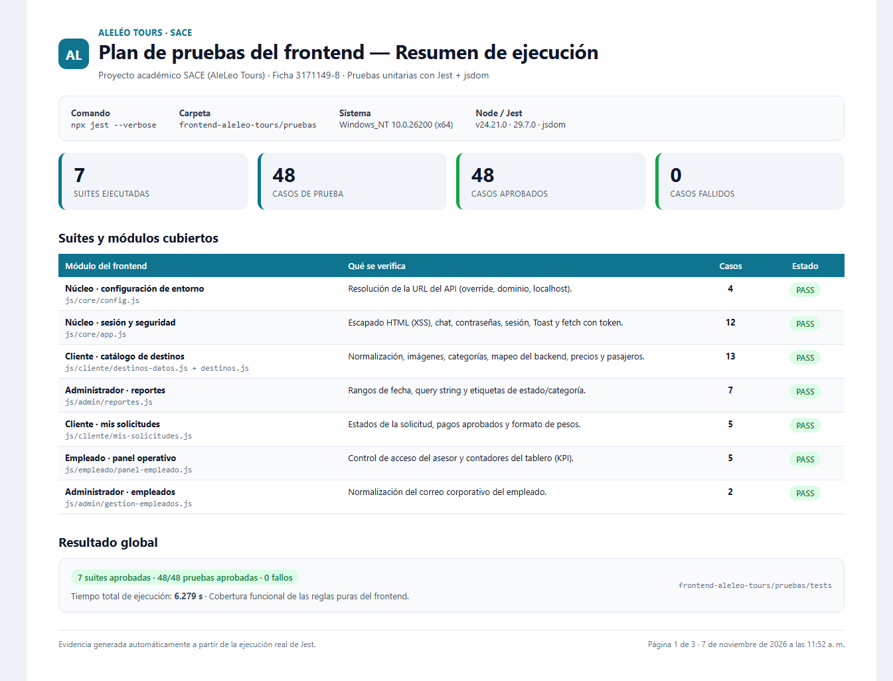
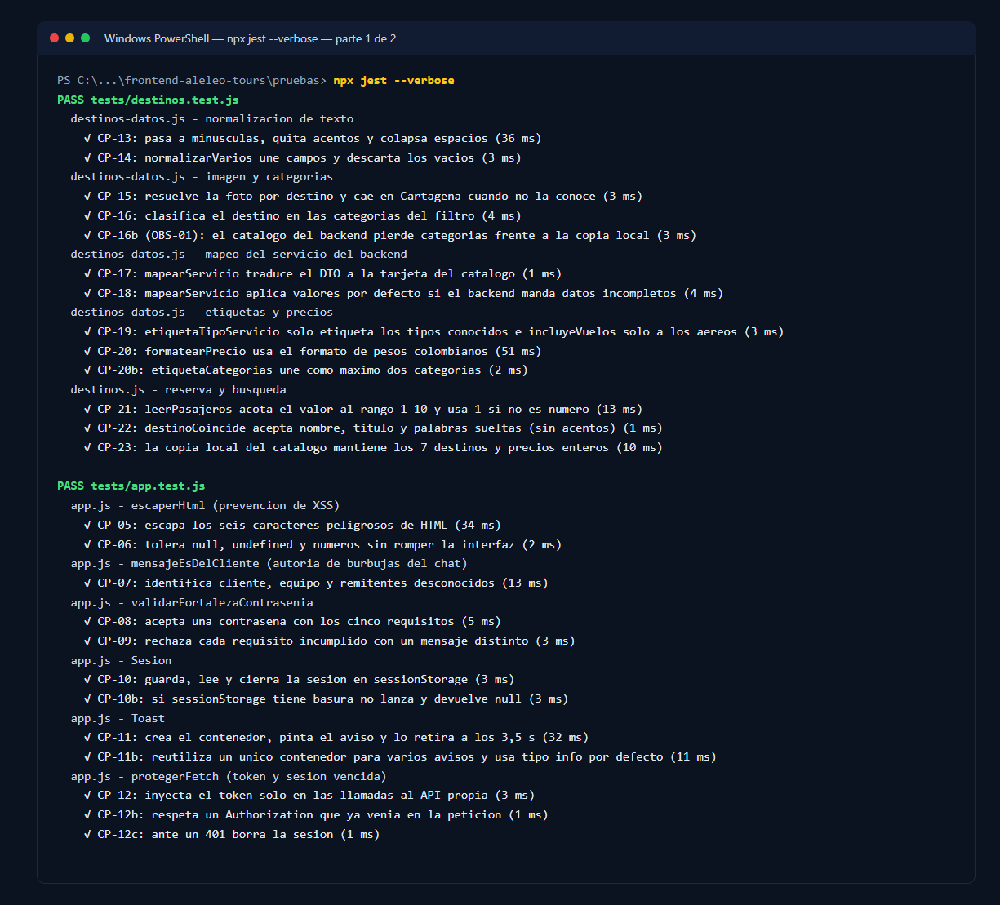
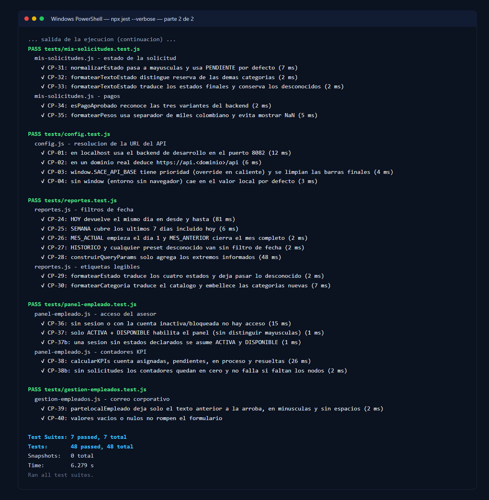
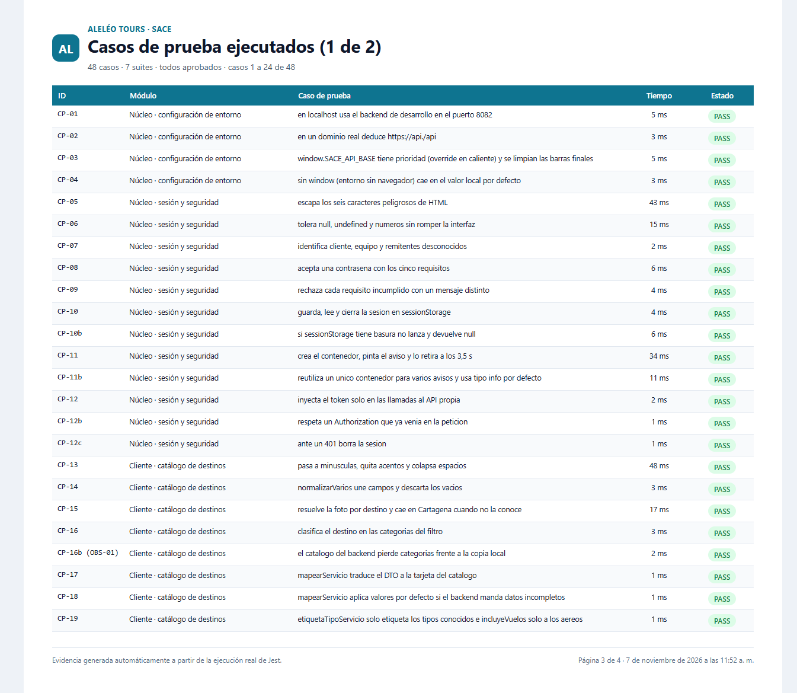
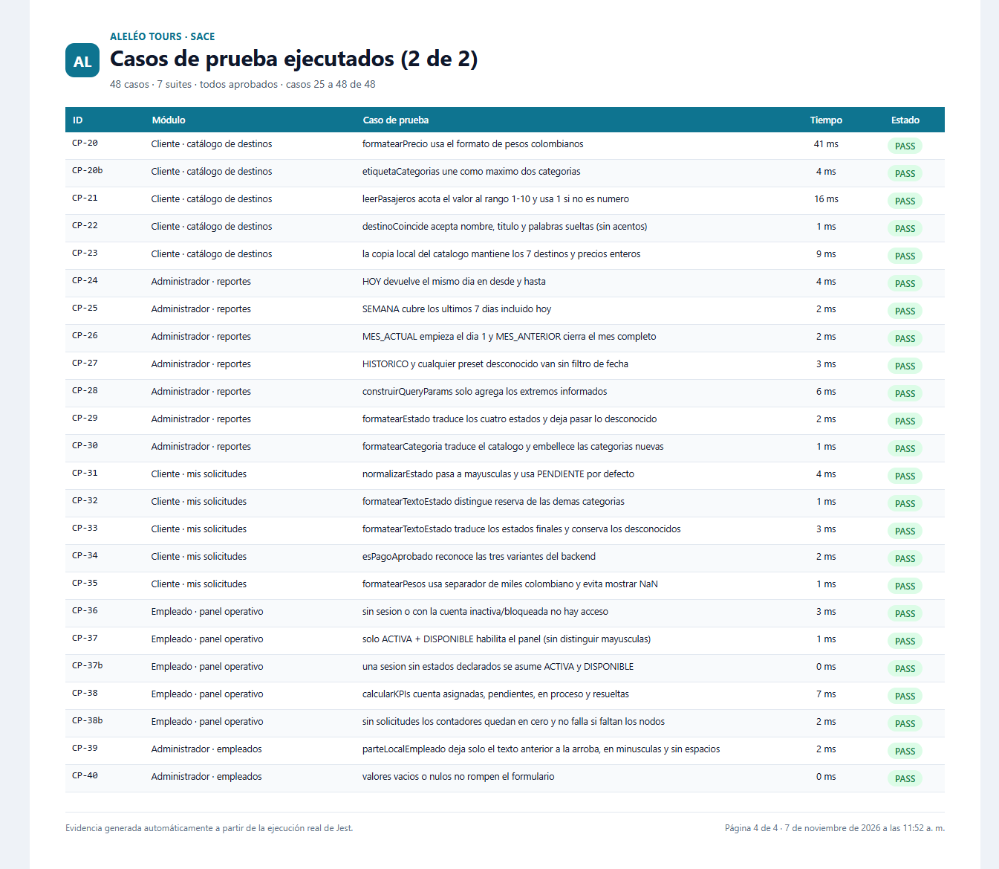

# Actividad 1 — Plan de pruebas del frontend con Jest

*Pruebas unitarias y de integración ligera sobre el sitio estático.*

| Dato | Valor |
|---|---|
| Integrantes | Cesar Leonardo Ramírez Montejo · Yerson Alexei Torres García · Felipe Gonzales Quitero |
| Programa | Análisis y Desarrollo de Software — SENA |
| Ficha | 3171149-B_ |
| Instructora | Claudia Yasmin Alba Acevedo |
| Proyecto | SACE — Sistema de Atención al Cliente (AleLeo Tours) |
| Fecha | 7 de noviembre de 2026 |
| Resultado | 7 suites · 48 casos · 48 aprobados · 0 fallidos |

# Contenido de la actividad

El documento desarrolla los nueve puntos solicitados en la guía de la actividad:

| **\#** | **Punto** | **Qué contiene** |
|:--:|----|----|
| 1 | Portada | Identificación del proyecto, integrantes, herramienta y fecha. |
| 2 | Introducción | Propósito, alcance y resultado general de la ejecución. |
| 3 | Estrategia y tipos de prueba | Enfoque, técnicas de diseño, niveles y matriz de riesgo. |
| 4 | Descripción del recurso o herramienta | Jest, jsdom, Node.js y estructura del proyecto de pruebas. |
| 5 | Casos de prueba | 40 casos (48 ejecuciones) con tabla de resultados y capturas de pantalla. |
| 6 | Responsable | Roles del equipo y responsabilidad de la ejecución. |
| 7 | Criterios de entrada y salida | Condiciones para iniciar, suspender y cerrar la ejecución. |
| 8 | Errores encontrados | Observación OBS-01, evidencia, impacto y recomendación. |
| 9 | Video corto | Guion escena por escena, comandos y checklist de grabación. |

<table>
<colgroup>
<col style="width: 100%" />
</colgroup>
<thead>
<tr>
<th>
<strong>Resumen ejecutivo</strong>

Se ejecutaron 48 pruebas automatizadas sobre 7 módulos del frontend: todas aprobaron en 6,3 segundos.

La suite corre con un solo comando (npx jest) y no requiere backend ni base de datos, por lo que puede repetirse en cada cambio del sitio. Se documentó 1 observación de severidad baja (OBS-01) sobre la clasificación de categorías del catálogo.
</th>
</tr>
</thead>
<tbody>
</tbody>
</table>

### Datos de la actividad

<table>
<colgroup>
<col style="width: 33%" />
<col style="width: 66%" />
</colgroup>
<thead>
<tr>
<th><strong>Integrantes</strong></th>
<th>Cesar Leonardo Ramírez Montejo 
Yerson Alexei Torres García 
Felipe Gonzales Quitero</th>
</tr>
</thead>
<tbody>
<tr>
<td><strong>Responsable de la actividad</strong></td>
<td>Cesar Leonardo Ramírez Montejo</td>
</tr>
<tr>
<td><strong>Módulo evaluado</strong></td>
<td>Frontend web (HTML, CSS y JavaScript vanilla)</td>
</tr>
<tr>
<td><strong>Herramienta</strong></td>
<td>Jest 29.7.0 + jest-environment-jsdom 29.7.0</td>
</tr>
<tr>
<td><strong>Fecha de ejecución</strong></td>
<td>7 de noviembre de 2026</td>
</tr>
<tr>
<td><strong>Repositorio del proyecto</strong></td>
<td>1_Proyecto_Git / Projecto_SACE / frontend-aleleo-tours</td>
</tr>
</tbody>
</table>

**Resultado de la ejecución: 7 suites · 48 casos · 48 aprobados · 0 fallidos**

# 2. Introducción

SACE (Sistema de Atención al Cliente) es el proyecto formativo de AleLeo Tours. El sistema se compone de un backend REST en Spring Boot y de un frontend web 100 % estático construido con HTML, CSS, Bootstrap y JavaScript vanilla. Este documento presenta el plan de pruebas del frontend y la ejecución real de ese plan con Jest.

El frontend concentra reglas que el usuario percibe de forma directa: la resolución de la URL del API, el escapado de datos antes de pintarlos (prevención de XSS), la validación de contraseñas, el manejo de la sesión y del token, el catálogo de destinos con sus precios y categorías, los filtros de reportes, los estados de las solicitudes y el control de acceso del panel del asesor. Un error en cualquiera de esas reglas no rompe el servidor, pero sí produce pantallas vacías, precios equivocados, filtros que no encuentran destinos o mensajes incomprensibles para el cliente.

La actividad tiene cuatro objetivos concretos:

- **Verificar** el comportamiento de las funciones críticas del frontend con datos reales y con datos límite.

- **Automatizar** la verificación para que pueda repetirse en cada entrega, sin depender de pruebas manuales.

- **Documentar** los casos de prueba, los criterios de entrada/salida y los errores encontrados.

- **Dejar evidencia** de la ejecución (salida de consola y capturas) para la sustentación del proyecto.

El alcance es el frontend. No se prueban aquí los endpoints del backend ni la base de datos: esas pruebas corresponden al plan de pruebas de la API. Tampoco se hacen pruebas de carga ni de usabilidad con usuarios reales; el documento indica esas limitaciones en el punto 3.

Resultado general: se diseñaron 40 casos de prueba que, por sus variantes de borde, se ejecutan como 48 pruebas automatizadas. Las 48 aprobaron. La ejecución completa tarda alrededor de 6 segundos y se encontró una observación menor que se documenta en el punto 8.

<table>
<colgroup>
<col style="width: 100%" />
</colgroup>
<thead>
<tr>
<th>
<strong>Dato de la ejecución</strong>

Comando: npx jest --verbose · Suites: 7/7 aprobadas · Pruebas: 48/48 aprobadas · Fallos: 0 · Tiempo: 6,279 s
</th>
</tr>
</thead>
<tbody>
</tbody>
</table>

# 3. Estrategia y tipos de prueba

## 3.1 Enfoque general

Se aplicó una estrategia de pruebas unitarias de caja blanca, complementadas con pruebas de integración ligera sobre el DOM. La diferencia con una prueba de extremo a extremo (E2E) es deliberada: en lugar de levantar el backend, la base de datos y un navegador, se cargan los archivos JavaScript reales del frontend en un DOM simulado (jsdom) y se invocan directamente las funciones que usa la interfaz. Así la retroalimentación es inmediata y el resultado no depende de la red ni de datos de la base.

El principio rector fue probar el código de producción sin copiarlo ni reescribirlo: el helper helpers/cargar-frontend.js lee los mismos archivos que carga el navegador, los evalúa en el ámbito global del DOM y expone únicamente las funciones que cada prueba necesita.

## 3.2 Tipos de prueba aplicados

| **Tipo de prueba** | **Qué se verificó** | **Ejemplo** |
|----|----|----|
| Unitaria de lógica pura | Entradas y salidas de funciones sin efectos secundarios. | normalizarBusqueda, formatearPrecio, calcularKPIs. |
| Integración con DOM (jsdom) | Funciones que crean o leen elementos de la página. | Toast.mostrar, Sesion.actualizar, leerPasajeros. |
| Seguridad del cliente | Saneamiento de HTML y manejo del token de sesión. | escaperHtml (XSS), protegerFetch (Bearer y 401). |
| Contrato de datos | Tolerancia a datos incompletos o mal formados del backend. | mapearServicio con precio no numérico o sin destino. |
| Valores límite | Extremos de los rangos permitidos. | pasajeros 0, -5, 1, 10, 99 y texto no numérico. |
| Regresión | Repetición automática de los 48 casos en cada cambio. | npx jest antes de cada entrega. |

## 3.3 Técnicas de diseño de casos

- **Partición de equivalencia:** se agruparon entradas que deben producir el mismo resultado (por ejemplo, estados válidos frente a estados desconocidos) y se probó un representante de cada grupo.

- **Análisis de valores límite:** se probaron los extremos de los rangos (0, 1, 10 y 99 pasajeros; fechas de inicio y fin de mes; cadenas vacías).

- **Casos negativos:** null, undefined, cadena vacía, JSON corrupto, precio no numérico y respuestas HTTP 401.

- **Dobles de prueba:** se reemplazó window.fetch por un espía de Jest para verificar cabeceras y códigos de respuesta sin llamar a la red.

- **Temporizadores falsos:** se simuló el paso del tiempo para comprobar que el aviso Toast desaparece a los 3,5 segundos y para fijar la fecha del 15 de marzo de 2026 en los filtros de reportes.

## 3.4 Niveles y alcance

| **Nivel** | **Incluido** | **Fuera del alcance** |
|----|----|----|
| Unitario | 7 módulos de js/ (núcleo, cliente, administrador y empleado). | Funciones de renderizado completas. |
| Integración | Interacción con el DOM simulado y con sessionStorage. | Navegador real, CSS y accesibilidad visual. |
| Sistema | No aplica en esta actividad. | Backend, base de datos y pasarela de pagos. |
| Aceptación | Validación del documento y de las evidencias. | Pruebas con usuarios finales. |

## 3.5 Matriz de riesgo

| **Riesgo** | **Probabilidad** | **Impacto** | **Cobertura en el plan** |
|----|:--:|:--:|----|
| XSS por datos del usuario | Media | Alto | CP-05 y CP-06 (escapado de HTML). |
| Token enviado a un dominio ajeno | Baja | Alto | CP-12, CP-12b y CP-12c. |
| Precio o categoría incorrectos en el catálogo | Media | Medio | CP-15 a CP-20 y CP-23. |
| Filtros de fecha mal calculados | Media | Medio | CP-24 a CP-28. |
| Acceso de un asesor inactivo | Baja | Alto | CP-36 y CP-37. |
| Pantalla en blanco por datos incompletos | Media | Medio | CP-06, CP-18 y CP-38b. |

# 4. Descripción del recurso o herramienta

## 4.1 Jest

Jest es el marco de pruebas de JavaScript mantenido por Meta. Se eligió porque integra en una sola herramienta el ejecutor de pruebas, las aserciones (expect), los dobles de prueba (jest.fn), los temporizadores simulados y los informes de resultados, sin necesidad de configurar un navegador ni un servidor. En este proyecto se usó la versión 29.7.0, la última de la rama 29, junto con jest-environment-jsdom 29.7.0.

| **Característica** | **Uso en este plan** |
|----|----|
| Ejecutor de pruebas | Descubre y ejecuta los archivos \*.test.js de la carpeta tests/. |
| Aserciones (expect) | Compara el resultado real con el esperado en cada caso (toBe, toEqual, toMatch). |
| Espías y mocks | Reemplaza window.fetch para verificar el token y el manejo del 401. |
| Temporizadores falsos | Simula 3,5 s del Toast y fija la fecha de los reportes. |
| Entorno jsdom | Proporciona document, window, sessionStorage y eventos del navegador. |
| Salida JSON | Permite generar la tabla de evidencias a partir de la ejecución real. |

## 4.2 jsdom y Node.js

jsdom es una implementación en JavaScript de los estándares del DOM. Jest la usa como entorno de pruebas para que el código del frontend encuentre document, window y sessionStorage como en un navegador. Node.js 24.21.0 ejecuta tanto a Jest como a jsdom; npm 11.19.0 administra las dos dependencias de desarrollo.

## 4.3 Por qué no se usaron otras herramientas

| **Alternativa** | **Motivo para descartarla** |
|----|----|
| Vitest | Está pensado para proyectos con Vite y módulos ES; el frontend es estático y sin build. |
| Cypress / Playwright (E2E) | Requieren navegador y backend levantados; son más lentos y no aíslan la lógica pura. |
| Karma + Jasmine | Configuración más extensa y enfoque heredado; Jest ya incluye espías y temporizadores. |
| Mocha + Chai + Sinon | Obliga a integrar tres paquetes y un reportero; Jest cubre todo en uno. |

## 4.4 Estructura del proyecto de pruebas

> frontend-aleleo-tours/
>
> ├── js/ \<- código de producción (no se modifica)
>
> └── pruebas/
>
> ├── package.json \<- Jest 29.7.0 + jest-environment-jsdom 29.7.0
>
> ├── jest.config.js \<- entorno jsdom, URL local y carpeta tests/
>
> ├── helpers/
>
> │ └── cargar-frontend.js \<- carga los scripts reales dentro del DOM
>
> ├── tests/
>
> │ ├── config.test.js
>
> │ ├── app.test.js
>
> │ ├── destinos.test.js
>
> │ ├── reportes.test.js
>
> │ ├── mis-solicitudes.test.js
>
> │ ├── panel-empleado.test.js
>
> │ └── gestion-empleados.test.js
>
> ├── resultados/ \<- salida de consola, JSON y generador de evidencias
>
> └── evidencia/ \<- capturas usadas en este documento

El helper es la pieza que permite probar el código real. Los archivos del frontend no son módulos: se declaran funciones globales y unos archivos usan lo que definen otros (por ejemplo, destinos.js usa normalizarBusqueda de destinos-datos.js). El helper concatena los archivos en el mismo orden en que los carga el HTML, los evalúa en el ámbito global y publica las funciones necesarias, sin copiar ni reformatear el código de producción.

## 4.5 Ejecución

> \# 1. Instalar dependencias (solo la primera vez)
>
> cd frontend-aleleo-tours/pruebas
>
> npm install
>
> \# 2. Ejecutar todas las pruebas
>
> npx jest --verbose
>
> \# 3. Ejecutar un solo módulo
>
> npx jest tests/destinos.test.js --verbose
>
> \# 4. Generar el JSON con los resultados
>
> npx jest --json --outputFile=resultados/resultados.json

La salida de la ejecución se guarda en resultados/salida-jest.txt y el JSON en resultados/resultados.json. Con esos dos archivos se generan las capturas y las tablas de este documento.

## 4.6 Limitaciones

- **No mide cobertura de líneas:** el código se evalúa con window.eval, por lo que Istanbul no puede instrumentarlo. La cobertura se expresa en términos de módulos y reglas cubiertas (7 de 13 archivos de js/, los que contienen lógica pura y de presentación crítica).

- **No reemplaza las pruebas E2E:** no valida la integración real con el backend ni el aspecto visual.

- **Depende del DOM simulado:** jsdom no implementa navegación ni todos los APIs del navegador; por eso las pruebas evitan las rutas que redirigen y se concentran en la lógica.

# 5. Casos de prueba

Se diseñaron 40 casos identificados como CP-01 a CP-40. Ocho de ellos tienen una variante de borde (sufijo b), de modo que la suite ejecuta 48 pruebas. Cada caso vive en un archivo de prueba y se identifica con el mismo código en la salida de Jest, lo que permite rastrear el resultado hasta el código fuente.

| **Suite** | **Módulo** | **Casos** | **Estado** |
|----|----|:--:|:--:|
| config.test.js | js/core/config.js | 4 | Aprobada |
| app.test.js | js/core/app.js | 12 | Aprobada |
| destinos.test.js | js/cliente/destinos-datos.js + destinos.js | 13 | Aprobada |
| reportes.test.js | js/admin/reportes.js | 7 | Aprobada |
| mis-solicitudes.test.js | js/cliente/mis-solicitudes.js | 5 | Aprobada |
| panel-empleado.test.js | js/empleado/panel-empleado.js | 5 | Aprobada |
| gestion-empleados.test.js | js/admin/gestion-empleados.js | 2 | Aprobada |
| Total | 7 suites | 48 | 48/48 |

## 5.1 Detalle de los casos ejecutados

| **ID** | **Caso de prueba** | **Resultado esperado** | **Estado** |
|:--:|----|----|:--:|
| CP-01 | en localhost usa el backend de desarrollo en el puerto 8082 | localhost y 127.0.0.1 resuelven http://localhost:8082/api. | PASS |
| CP-02 | en un dominio real deduce https://api.\<dominio\>/api | www.aleleotours.com resuelve https://api.aleleotours.com/api. | PASS |
| CP-03 | window.SACE_API_BASE tiene prioridad (override en caliente) y se limpian las barras finales | El override gana y se eliminan las barras finales. | PASS |
| CP-04 | sin window (entorno sin navegador) cae en el valor local por defecto | Sin host cae en el valor local por defecto. | PASS |
| CP-05 | escapa los seis caracteres peligrosos de HTML | Los seis caracteres peligrosos se convierten en entidades HTML. | PASS |
| CP-06 | tolera null, undefined y numeros sin romper la interfaz | null/undefined devuelven cadena vacía; los números se convierten. | PASS |
| CP-07 | identifica cliente, equipo y remitentes desconocidos | Cliente y desconocido devuelven true; equipo devuelve false. | PASS |
| CP-08 | acepta una contrasena con los cinco requisitos | Una contraseña completa es válida y no genera mensaje. | PASS |
| CP-09 | rechaza cada requisito incumplido con un mensaje distinto | Cada requisito incumplido produce su mensaje específico. | PASS |
| CP-10 | guarda, lee y cierra la sesion en sessionStorage | Guardar, leer y cerrar la sesión funciona sobre sessionStorage. | PASS |
| CP-10b | si sessionStorage tiene basura no lanza y devuelve null | Un JSON corrupto no lanza excepción: devuelve null. | PASS |
| CP-11 | crea el contenedor, pinta el aviso y lo retira a los 3,5 s | Crea el contenedor, pinta el aviso y lo retira a los 3500 ms. | PASS |
| CP-11b | reutiliza un unico contenedor para varios avisos y usa tipo info por defecto | Un solo contenedor y tipo 'info' por defecto. | PASS |
| CP-12 | inyecta el token solo en las llamadas al API propia | El token solo se agrega a las llamadas del API propia. | PASS |
| CP-12b | respeta un Authorization que ya venia en la peticion | Se respeta el Authorization que ya traía la petición. | PASS |
| CP-12c | ante un 401 borra la sesion | Una respuesta 401 borra la sesión del usuario. | PASS |
| CP-13 | pasa a minusculas, quita acentos y colapsa espacios | ' San ANDRÉS ' se normaliza a 'san andres'. | PASS |
| CP-14 | normalizarVarios une campos y descarta los vacios | Une los campos no vacíos separados por un espacio. | PASS |
| CP-15 | resuelve la foto por destino y cae en Cartagena cuando no la conoce | Imagen por destino; un destino desconocido usa Cartagena. | PASS |
| CP-16 | clasifica el destino en las categorias del filtro | Categorías por palabra clave; sin coincidencia usa playa y ciudad. | PASS |
| CP-16b | el catalogo del backend pierde categorias frente a la copia local | OBS-01: el catálogo del backend pierde categorías frente al local. | PASS |
| CP-17 | mapearServicio traduce el DTO a la tarjeta del catalogo | El DTO se traduce a la tarjeta con imagen y categorías. | PASS |
| CP-18 | mapearServicio aplica valores por defecto si el backend manda datos incompletos | Precio no numérico = 0 y se aplican los valores por defecto. | PASS |
| CP-19 | etiquetaTipoServicio solo etiqueta los tipos conocidos e incluyeVuelos solo a los aereos | Solo los tipos aéreos anuncian vuelos. | PASS |
| CP-20 | formatearPrecio usa el formato de pesos colombianos | Devuelve '\$ 320.000 COP' con el formato colombiano. | PASS |
| CP-20b | etiquetaCategorias une como maximo dos categorias | Une como máximo dos categorías ('Playa y Ciudad'). | PASS |
| CP-21 | leerPasajeros acota el valor al rango 1-10 y usa 1 si no es numero | Acota a 1-10 y usa 1 cuando el valor no es numérico. | PASS |
| CP-22 | destinoCoincide acepta nombre, titulo y palabras sueltas (sin acentos) | Coincide por nombre, título o palabras, sin acentos. | PASS |
| CP-23 | la copia local del catalogo mantiene los 7 destinos y precios enteros | Los 7 destinos locales tienen precio, imagen y categorías. | PASS |
| CP-24 | HOY devuelve el mismo dia en desde y hasta | HOY devuelve el mismo día en desde y hasta. | PASS |
| CP-25 | SEMANA cubre los ultimos 7 dias incluido hoy | SEMANA cubre 7 días (6 de diferencia). | PASS |
| CP-26 | MES_ACTUAL empieza el dia 1 y MES_ANTERIOR cierra el mes completo | MES_ACTUAL inicia el día 1; MES_ANTERIOR cierra el mes. | PASS |
| CP-27 | HISTORICO y cualquier preset desconocido van sin filtro de fecha | HISTÓRICO y presets desconocidos van sin fechas. | PASS |
| CP-28 | construirQueryParams solo agrega los extremos informados | El query string solo incluye los extremos informados. | PASS |
| CP-29 | formatearEstado traduce los cuatro estados y deja pasar lo desconocido | Traduce los estados y conserva los desconocidos. | PASS |
| CP-30 | formatearCategoria traduce el catalogo y embellece las categorias nuevas | Traduce las categorías; null devuelve 'Consulta General'. | PASS |
| CP-31 | normalizarEstado pasa a mayusculas y usa PENDIENTE por defecto | Pasa a mayúsculas y usa PENDIENTE por defecto. | PASS |
| CP-32 | formatearTextoEstado distingue reserva de las demas categorias | Reserva habla de pago; las demás categorías, de atención. | PASS |
| CP-33 | formatearTextoEstado traduce los estados finales y conserva los desconocidos | Traduce los estados finales y conserva los desconocidos. | PASS |
| CP-34 | esPagoAprobado reconoce las tres variantes del backend | APROBADO, APPROVED y CONFIRMADO cuentan como pago aprobado. | PASS |
| CP-35 | formatearPesos usa separador de miles colombiano y evita mostrar NaN | Formatea 320.000 y 1.234,5; un valor inválido da '0'. | PASS |
| CP-36 | sin sesion o con la cuenta inactiva/bloqueada no hay acceso | Sin sesión o con la cuenta inactiva no hay acceso. | PASS |
| CP-37 | solo ACTIVA + DISPONIBLE habilita el panel (sin distinguir mayusculas) | Solo ACTIVA + DISPONIBLE habilita el panel. | PASS |
| CP-37b | una sesion sin estados declarados se asume ACTIVA y DISPONIBLE | Sin estados declarados se asume ACTIVA y DISPONIBLE. | PASS |
| CP-38 | calcularKPIs cuenta asignadas, pendientes, en proceso y resueltas | Los KPI cuentan 6 asignadas, 2 pendientes, 1 en proceso y 2 resueltas. | PASS |
| CP-38b | sin solicitudes los contadores quedan en cero y no falla si faltan los nodos | Sin solicitudes los contadores quedan en cero. | PASS |
| CP-39 | parteLocalEmpleado deja solo el texto anterior a la arroba, en minusculas y sin espacios | 'Diana.Lopez@…' se reduce a 'diana.lopez'. | PASS |
| CP-40 | valores vacios o nulos no rompen el formulario | Los valores vacíos no rompen el formulario. | PASS |

*Los 48 casos finalizaron en estado PASS. La columna 'Estado' resume el veredicto de Jest: el valor real coincidió con el esperado en todas las aserciones.*

## 5.2 Evidencias de la ejecución

Las capturas se generaron a partir de la salida real de la consola y del archivo JSON que produce Jest. No son maquetas: reflejan exactamente los 7 PASS, los 48 casos y el tiempo de ejecución de la corrida del 7 de noviembre de 2026.

*Figura 1. Resumen de la ejecución: 7 suites, 48 casos, 48 aprobados y 0 fallidos.*

*Figura 2. Salida real de 'npx jest --verbose' (parte 1 de 2): módulos de destinos y núcleo.*

*Figura 3. Salida real de 'npx jest --verbose' (parte 2 de 2): resto de módulos y resumen final.*

*Figura 4. Detalle de los casos 1 a 24: identificador, módulo, descripción, tiempo y estado.*

*Figura 5. Detalle de los casos 25 a 48 de la suite.*

# 6. Responsable

La actividad fue ejecutada por Cesar Leonardo Ramírez Montejo, integrante encargado del backend, la API y el despliegue. Para esta entrega asumió además la redacción del plan de pruebas del frontend y la ejecución de la suite con Jest.

| **Rol** | **Nombre** | **Responsabilidad en esta actividad** |
|----|----|----|
| Responsable de la ejecución | Cesar Leonardo Ramírez Montejo | Diseño de los casos, configuración de Jest, ejecución, capturas y documento. |
| Revisión de la lógica del frontend | Felipe Gonzales Quitero | Validación de que los casos cubren las funciones reales del sitio. |
| Revisión de datos y evidencias | Yerson Alexei Torres García | Verificación de los datos del catálogo y de la coherencia con la base de datos. |
| Docente / instructor | \_\_\_\_\_\_\_\_\_\_\_\_\_\_\_\_\_\_\_\_\_\_\_\_ | Revisión, retroalimentación y aprobación de la entrega. |

*Responsable técnico del frontend en el proyecto: Felipe Gonzales Quitero. Responsable del repositorio y de la entrega: Cesar Leonardo Ramírez Montejo. La ejecución se realizó en el equipo de trabajo con Windows 10, Node.js 24.21.0 y npm 11.19.0.*

# 7. Criterios de entrada y salida

## 7.1 Criterios de entrada

La ejecución se puede iniciar cuando se cumplen todas estas condiciones:

- El código del frontend está disponible y sin cambios pendientes por guardar.

- Node.js y npm están instalados (probado con Node 24.21.0 y npm 11.19.0).

- La carpeta pruebas/ contiene package.json, jest.config.js, el helper y los siete archivos de prueba.

- Las dependencias están instaladas (node_modules con Jest y jest-environment-jsdom).

- El entorno de ejecución tiene al menos 200 MB libres y permisos de escritura en pruebas/resultados.

- Los casos de prueba están revisados y aprobados por el equipo.

No se requiere backend en ejecución, base de datos, conexión a internet ni cuentas de usuario: las pruebas son autocontenidas.

## 7.2 Criterios de salida

- **Cobertura de ejecución:** los 48 casos se ejecutaron; ninguno quedó omitido (skipped) ni pendiente.

- **Resultado:** 48/48 en estado PASS y 0 fallos.

- **Trazabilidad:** cada caso tiene identificador CP, módulo, resultado esperado y evidencia en la consola.

- **Evidencias:** se generaron y almacenaron las capturas del resumen, la consola y el detalle de casos.

- **Defectos:** todo comportamiento no conforme quedó registrado en el punto 8 con severidad e impacto.

- **Documento:** el plan está completo, con portada, introducción, estrategia, herramienta, casos, responsable, criterios, errores y guion del video.

## 7.3 Criterios de suspensión y reanudación

| **Situación** | **Acción** |
|----|----|
| Falla la instalación de dependencias | Se detiene la ejecución y se corrige el entorno antes de continuar. |
| Más del 20 % de los casos falla | Se suspende, se analiza la causa raíz y se corrige el código o el caso. |
| Un caso depende de datos externos | Se reemplaza por un doble de prueba o se marca fuera de alcance. |
| El código del frontend cambia durante la corrida | Se repite la suite completa para evitar resultados obsoletos. |
| Un fallo no se puede reproducir | Se documenta como intermitente y se adjunta la salida de consola. |

# 8. Errores encontrados

Durante la ejecución no se presentaron fallos bloqueantes: los 48 casos aprobaron. Sí se identificó una inconsistencia funcional que no rompe la aplicación, pero afecta los filtros del catálogo. Se registra a continuación con su evidencia y recomendación.

| **ID** | **Severidad** | **Módulo** | **Descripción** | **Estado** |
|:--:|:--:|----|----|:--:|
| OBS-01 | Baja | js/cliente/destinos-datos.js | El catálogo local y el que llega del backend asignan categorías distintas a los mismos destinos. | Abierto |

## 8.1 OBS-01 — Categorías inconsistentes entre la copia local y el backend

La lista DESTINOS_DEFAULT declara Cartagena como 'playa' y 'ciudad', y Tayrona como 'naturaleza' y 'playa'. Sin embargo, cuando el catálogo se pinta desde GET /api/servicios, la función resolverCategorias() clasifica los mismos destinos solo con las palabras clave de su tabla interna: Cartagena queda únicamente como 'playa' y Tayrona únicamente como 'naturaleza'.

Consecuencia: al usar los filtros del catálogo, una búsqueda por 'Ciudad' no muestra Cartagena y una búsqueda por 'Playa' no muestra Tayrona, aunque la copia local del mismo plan sí las mostraría. El usuario percibe que el filtro 'pierde' destinos según el origen de los datos.

Evidencia automatizada (caso CP-16b):

> const local = DESTINOS_DEFAULT.find(d =\> d.nombre === 'Cartagena');
>
> local.categorias // \['playa', 'ciudad'\]
>
> const backend = mapearServicio({ nombre: 'Paquete Vacacional Cartagena',
>
> destino: 'Cartagena', ... });
>
> backend.categorias // \['playa'\] \<- falta 'ciudad'
>
> // Lo mismo ocurre con Tayrona: local \['naturaleza', 'playa'\] vs backend \['naturaleza'\]

Causa raíz: existen dos fuentes de verdad para las categorías. La copia local las escribe a mano y resolverCategorias() las deduce de una tabla de palabras clave que no incluye 'cartagena' en 'ciudad' ni 'tayrona' en 'playa'.

Recomendación (no aplicada en esta actividad porque el alcance es el plan de pruebas):

- Unificar la clasificación en una sola fuente: que DESTINOS_DEFAULT también se construya con resolverCategorias().

- Ampliar la tabla de palabras clave para que la deducción coincida con la intención del catálogo.

- Agregar una prueba de regresión que compare, destino por destino, las categorías del catálogo local con las del backend.

<table>
<colgroup>
<col style="width: 100%" />
</colgroup>
<thead>
<tr>
<th>
<strong>Impacto y prioridad</strong>

Severidad baja: no impide reservar ni genera errores de datos; afecta la experiencia de búsqueda y los filtros.

Prioridad sugerida: incluir la corrección en el próximo sprint del frontend y repetir la suite para verificar.

Estado: abierto y documentado; la prueba CP-16b quedará en rojo cuando se corrija, avisando del cambio.
</th>
</tr>
</thead>
<tbody>
</tbody>
</table>

## 8.2 Comportamientos verificados que no son defectos

Varios comportamientos podrían parecer errores en una lectura rápida, pero son decisiones deliberadas del frontend. Se dejaron cubiertos por pruebas para que un cambio futuro no las rompa sin aviso.

| **Comportamiento observado** | **Por qué es correcto** | **Caso que lo cubre** |
|----|----|:--:|
| Un destino sin imagen conocida usa la foto de Cartagena. | Es un respaldo intencional: evita que la tarjeta quede rota o vacía. | CP-15 |
| Un estado o una categoría desconocidos se muestran tal cual. | Evita ocultar información nueva que el backend ya reconozca. | CP-29 y CP-30 |
| Una sesión sin estados declarados se asume ACTIVA y DISPONIBLE. | Es el valor por defecto histórico del sistema para cuentas antiguas. | CP-37b |
| Un precio no numérico se muestra como 0 en lugar de NaN. | Protege la interfaz ante datos corruptos o incompletos del backend. | CP-18 y CP-35 |
| Una cadena vacía en el campo de estado vuelve a PENDIENTE. | Mantiene una etiqueta comprensible aunque el dato llegue sin diligenciar. | CP-31 |
| El token solo se agrega cuando la URL pertenece al API propia. | Impide filtrar credenciales hacia dominios externos. | CP-12 y CP-12b |

*En conjunto, los 48 casos no solo confirman el camino feliz: también fijan el comportamiento esperado ante datos límite, datos corruptos y accesos no autorizados. Esa es la base para que la suite funcione como red de seguridad en las próximas entregas.*

# 9. Video corto con la ejecución de las pruebas

El video debe mostrar la ejecución real de la suite, no una presentación de diapositivas. La duración objetivo es de 4 a 5 minutos y se graba en una sola toma continua (se puede editar solo para recortar silencios). A continuación se entrega el guion escena por escena, los comandos exactos y una lista de verificación antes de grabar.

## 9.1 Preparación previa

- Abrir PowerShell en frontend-aleleo-tours/pruebas y ejecutar npm install una vez.

- Ampliar la fuente de la terminal a 16-18 pt para que el texto se lea en el video.

- Cerrar notificaciones y ventanas que puedan distraer; dejar solo el editor y la terminal.

- Grabar a 1080p, con micrófono, y comprobar el audio con una prueba de 10 segundos.

- Tener a mano este documento para seguir el guion.

## 9.2 Guion escena por escena

| **Escena** | **Tiempo** | **Qué se muestra** | **Qué se dice (resumen)** |
|----|:--:|----|----|
| 1\. Presentación | 0:00-0:25 | Pantalla del proyecto y portada del documento. | Nombre, ficha, proyecto SACE y objetivo: probar el frontend con Jest. |
| 2\. Contexto | 0:25-0:55 | Árbol de la carpeta pruebas/ (package.json, jest.config.js, tests/). | Explicar que el frontend es estático y que se prueban los scripts reales en jsdom. |
| 3\. Ejecución | 0:55-1:45 | npx jest --verbose y la salida avanzando. | Narrar los módulos que aparecen: config, app, destinos, reportes, solicitudes, panel y empleados. |
| 4\. Resultado | 1:45-2:20 | Final de la salida: 7 passed y 48 passed. | Destacar 0 fallos y el tiempo de ejecución; relacionarlo con los criterios de salida. |
| 5\. Un caso | 2:20-3:10 | Abrir tests/destinos.test.js y señalar CP-21 (límites de pasajeros). | Explicar la técnica de valores límite: 0, 1, 10, 99 y texto no numérico. |
| 6\. Regresión (opcional) | 3:10-3:50 | Cambiar temporalmente un valor esperado, ejecutar y ver el FAIL; deshacer y ver el PASS. | Demostrar que la suite detecta un cambio y protege el comportamiento. |
| 7\. Cierre | 3:50-4:30 | Resumen de la ejecución y documento final. | Conclusiones: 48/48, una observación registrada y el comando para repetir la suite. |

## 9.3 Comandos que deben aparecer en el video

> \# Situarse en la carpeta de pruebas
>
> cd "C:\Users\cesar\OneDrive\Escritorio\SACE_Entrega_Final\1_Proyecto_Git\Projecto_SACE\frontend-aleleo-tours\pruebas"
>
> \# Ejecutar toda la suite
>
> npx jest --verbose
>
> \# (Opcional) Ejecutar solo el módulo del catálogo
>
> npx jest tests/destinos.test.js --verbose
>
> \# (Opcional) Generar el JSON de resultados
>
> npx jest --json --outputFile=resultados/resultados.json

## 9.4 Lista de verificación antes de entregar el video

- Se ve el comando npx jest --verbose escrito completo.

- La salida muestra los 7 archivos con PASS y el resumen 'Tests: 48 passed, 48 total'.

- Se explica al menos un caso de prueba con su código y su resultado esperado.

- Se menciona la observación OBS-01 y por qué no bloquea la entrega.

- El audio es claro, sin ruido y sincronizado con la pantalla.

- El video dura entre 4 y 5 minutos y está en formato MP4 a 1080p.

- El archivo se nombra Actividad1_PlanPruebas_Frontend_Jest_Apellidos.mp4.

# Anexo A. Cómo reproducir la entrega

La entrega se compone de los siguientes archivos y carpetas:

| **Elemento** | **Ruta** |
|----|----|
| Documento | docs/Actividad-01-Plan-de-Pruebas-Frontend-Jest.md |
| Versión Word (entrega) | `SACE_Entrega_Final/2_Evidencias_Documentales/6_Pruebas/Plan-de-Pruebas-Frontend-Jest.docx` |
| Proyecto de pruebas | frontend-aleleo-tours/pruebas/ |
| Casos automatizados | frontend-aleleo-tours/pruebas/tests/ (7 archivos, 48 casos) |
| Helper de carga | frontend-aleleo-tours/pruebas/helpers/cargar-frontend.js |
| Salida de consola | frontend-aleleo-tours/pruebas/resultados/salida-jest.txt |
| Resultados JSON | frontend-aleleo-tours/pruebas/resultados/resultados.json |
| Capturas | frontend-aleleo-tours/pruebas/evidencia/ (01-resumen, 02-consola-1, 02-consola-2, 03-casos-1 y 03-casos-2) |

Para repetir la ejecución desde cero: npm install dentro de pruebas/ y luego npx jest --verbose. Para regenerar las capturas: node resultados/generar-evidencia.js y abrir los HTML de evidencia/ en el navegador.

# Anexo B. Glosario breve

| **Término** | **Definición** |
|----|----|
| Jest | Marco de pruebas de JavaScript con aserciones, mocks y temporizadores. |
| jsdom | Implementación del DOM del navegador en JavaScript, usada como entorno de prueba. |
| Caso de prueba | Conjunto de datos de entrada, pasos y resultado esperado que se verifica. |
| PASS / FAIL | Resultado de una prueba: coincidió o no con lo esperado. |
| Mock / espía | Objeto simulado que registra cómo se usó y evita llamadas reales. |
| Valor límite | Extremo de un rango válido, donde suelen aparecer los errores. |
| Regresión | Repetición de las pruebas para asegurar que un cambio no rompió lo anterior. |
